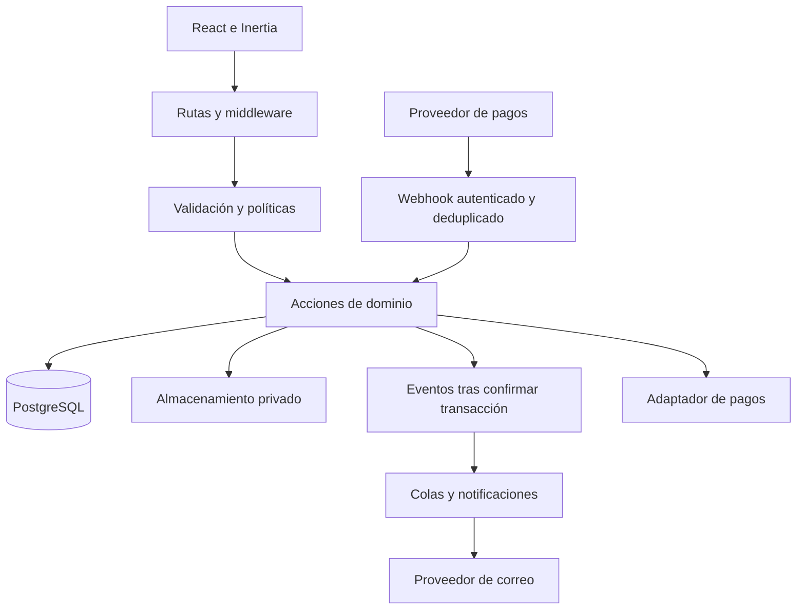

# Arquitectura y dominio de IDEVERA STUDIO

Este documento organiza la implementación de los [requisitos](../IDEVERA_REQUERIMIENTOS_CLIENTE_MVP_V1.docx) sobre la base instalada. F1 ya incorpora User con rol, ClientProfile, StaffProfile, AuditEvent, enums, política de usuarios y acciones de cuentas; consultar [su entrega y evidencia](F1_ROLES_Y_ACCESO.md). Las demás entidades son propuestas para sus fases. Los vocabularios de estados de la sección 4 reproducen el Word; las transiciones de cuentas están definidas en F1 y las de los demás módulos se concretarán antes de programar cada flujo.

Contexto acordado el 11 de octubre de 2026: proyecto de pruebas desarrollado en local hasta terminarlo, sin dominio comprado ni cuenta oficial de Culqi. PayPal está previsto, inicialmente en Sandbox. Una posible demo en alojamiento/base gratuitos se estudia después de completar la validación local.

## 1 Arquitectura de la aplicación

Usaremos una aplicación Laravel organizada por módulos, con React y TypeScript mediante Inertia. Laravel será la fuente de verdad de permisos, relaciones, estados, importes y operaciones críticas. React presentará los datos autorizados, gestionará formularios y mostrará progreso y errores. PostgreSQL almacenará el dominio; archivos privados y contenidos públicos tendrán almacenamiento separado.



No necesitamos una API independiente para servir los paneles. Los endpoints de acciones, uploads y consulta incremental pertenecen a la misma aplicación y usan su sesión, CSRF y autorización. Tampoco se añade una aplicación PWA, service worker o promesa de operación offline; se recuperarán borradores y datos de formularios de manera controlada cuando falle la red.

## 2 Organización propuesta del código

La aplicación sigue en `idevera-base/`. Se conserva la estructura convencional de Laravel; las carpetas se crean cuando tengan una funcionalidad que contener.

```text
idevera-base/
  app/
    Actions/{Accounts,Requests,Quotes,Projects,Work,Deliverables,Payments,Content}/
    Enums/
    Events/
    Http/Controllers/{Public,Client,Staff,Owner}/
    Http/Requests/{Accounts,Requests,Quotes,Projects,Work,Deliverables,Payments}/
    Jobs/
    Models/
    Notifications/
    Policies/
    Services/{Files,Payments}/
  database/{migrations,factories,seeders}/
  resources/js/
    components/{ui,brand,forms,feedback,projects,messaging}/
    layouts/{public,client,staff,owner}/
    pages/{public,client,staff,owner,auth,settings}/
    types/
  routes/{web,client,staff,owner}.php
  tests/{Feature,Unit}/
```

Los controladores coordinan peticiones. Los Form Requests validan entrada y las políticas autorizan el recurso. Las acciones encapsulan operaciones como `SubmitRequest`, `PublishQuoteVersion`, `AcceptQuoteVersion`, `CreateProjectFromAcceptance` y `ApproveDeliverableVersion`, con transacción cuando corresponda. Se reutilizan desde HTTP, jobs y comandos para evitar reglas diferentes según el punto de entrada.

Las políticas de Laravel agrupan autorización por recurso. Gates pueden cubrir accesos generales como un dashboard, manteniendo el control de cada objeto en su política. [Documentación oficial](https://laravel.com/framework/docs/13.x/authorization).

## 3 Entidades y relaciones propuestas

Los nombres son orientativos para diseñar migraciones; no constituyen un esquema ya instalado. Los perfiles globales y sus estados se separan para no inventar un catálogo común que cambie los requisitos.

| Módulo | Entidades propuestas | Relaciones y datos importantes |
| --- | --- | --- |
| Identidad | User, ClientProfile, StaffProfile, StaffSpecialty | Usuario autenticado; rol global propuesto; estado propio del perfil; varias especialidades por staff |
| Público | ContentEntry (SERVICE/PORTFOLIO/PAGE), ContentMedia, SiteSetting, ContactMessage, ContentChange | Implementado en F3: borrador y copia publicada independientes, medios elegidos, portfolio–servicios y contacto privado OWNER |
| Solicitudes | ProjectRequest, RequestService, RequestInternalNote | Cliente propietario, brief, estado, fechas y servicio(s) aplicables; notas internas separadas |
| Cotizaciones | QuoteFamily, QuoteVersion, QuoteLine, QuoteMilestone | Familia vinculada a solicitud; versiones numeradas; snapshot de alcance, moneda, importes, condiciones y vigencia |
| Aceptación | QuoteAcceptance | Una aceptación válida por familia; versión exacta, actor y fecha; snapshot congelado |
| Proyecto | Project, ProjectMember, ProjectStateChange | Proyecto vinculado de forma única a aceptación; cliente, fechas, operación y finanzas separados; miembros y responsabilidades |
| Trabajo | WorkItem, WorkAssignment, WorkComment, WorkStateChange | Tipo EPIC/STORY/TASK, jerarquía del mismo proyecto, prioridad, estado, autor y responsables |
| Entregables | Deliverable, DeliverableVersion, DeliverableReview | Versiones numeradas, archivos, comentarios y decisión de revisión vinculada a la versión exacta |
| Archivos | FileAsset y vínculos contextuales | Propietario, disco privado, nombre original, tamaño, MIME verificado, hash y contexto autorizado |
| Mensajería | Conversation, ConversationParticipant, Message, MessageAttachment, ConversationRead | Contexto solicitud/proyecto, participantes, texto, timestamps y última lectura por usuario |
| Pendientes | Notification, RequiredAction | Notificación con lectura propia; acción requerida con recurso, responsable y resolución; conceptos distintos del chat |
| Pagos | PaymentPlan, PaymentMilestone, PaymentTransaction, FinancialEntry, ProviderEvent | Plan asociado a aceptación, posteriormente relacionado con proyecto; importes, monedas, intentos, conciliación e historial |
| Auditoría | AuditEvent | Actor, acción, recurso, fecha, resultado y cambios permitidos, sin secretos ni contenido privado innecesario |

Se aprovecharán las notificaciones y tablas de infraestructura de Laravel cuando corresponda. Las propuestas de contenido publicado no añaden estados al catálogo de negocio: se pueden representar con fechas/campos de publicación.

### Relaciones que deben ser inequívocas

- CLIENT posee solicitudes; las familias de cotización se vinculan a esas solicitudes.
- QuoteFamily tiene varias QuoteVersion y como máximo una QuoteAcceptance válida. La unicidad de familia por solicitud se confirmará al diseñar el editor; el versionado no se sustituye por nuevas familias sin motivo.
- Project tiene una aceptación única. Una aceptación no puede producir dos proyectos válidos.
- PaymentPlan parte de QuoteAcceptance para permitir el pago antes de existir Project. Al crear el proyecto conserva la referencia financiera previa.
- ProjectMember vincula usuario y proyecto con responsabilidad; una membresía vigente no es un rol global.
- WorkItem y sus padres pertenecen al mismo proyecto. Se impiden ciclos; la jerarquía y los elementos independientes se validan según el modelo acordado.
- DeliverableVersion y DeliverableReview siempre apuntan al entregable y versión correctos. Una revisión de una versión antigua no aprueba la actual.
- Los adjuntos no heredan permisos de un usuario arbitrario enviado por el navegador. Se autoriza tanto el archivo como su relación con el contexto.
- Una entrada pública del portfolio es un contenido publicado expresamente; no convierte el proyecto privado ni sus archivos en públicos.

### Datos, índices y restricciones

- Claves foráneas y restricciones de unicidad para relaciones críticas, aceptación y creación de proyecto.
- Números de versión únicos dentro de su familia/entregable; asignación segura ante edición simultánea.
- Índices de acceso por propietario, proyecto, estado y fecha; listas paginadas y consultas acotadas.
- Importes con representación exacta, moneda y escala explícitas; no usar floats para calcular dinero ni asumir que toda moneda tiene dos decimales.
- Fechas almacenadas de forma coherente en UTC y presentadas en la zona acordada del usuario/estudio.
- Identificadores externos y claves de eventos financieros únicos según proveedor y contexto.
- Versiones publicadas y aceptadas protegidas contra actualización ordinaria de su contenido. Los snapshots no dependen de un servicio o perfil que cambie después.
- Al desactivar cuentas o archivar proyectos se mantiene historial conforme a retención; no aplicar cascadas destructivas a evidencia comercial o financiera por comodidad.

## 4 Catálogo de estados del Word

Estos valores son la fuente de los enums y validadores. La UI puede traducir sus etiquetas, pero no alterar su significado o valor persistido.

| Dominio | Valores exactos |
| --- | --- |
| Rol global | CLIENT, STAFF, OWNER; visitante es ausencia de cuenta/rol |
| Cliente | PENDING_VERIFICATION, ACTIVE, SUSPENDED, DEACTIVATED |
| Staff | ACTIVE, INACTIVE, SUSPENDED |
| Responsabilidad de proyecto | TEAM_MEMBER, PROJECT_LEAD, SCRUM_MASTER |
| Solicitud | DRAFT, SUBMITTED, UNDER_REVIEW, WAITING_FOR_CLIENT, READY_TO_QUOTE, QUOTED, CONVERTED, REJECTED, CANCELLED, CLOSED |
| Quote Family | DRAFTING, ACTIVE, NEGOTIATION, ACCEPTED, REJECTED, EXPIRED, WITHDRAWN, CLOSED |
| Quote Version | DRAFT, SENT, VIEWED, SUPERSEDED, ACCEPTED, REJECTED, EXPIRED, WITHDRAWN |
| Proyecto operacional | AWAITING_PAYMENT, READY_FOR_ONBOARDING, PLANNING, ACTIVE, WAITING_FOR_CLIENT, PAUSED, FINAL_REVIEW, COMPLETED, CANCELLED, ARCHIVED |
| Tipo de trabajo | EPIC, STORY, TASK |
| Trabajo | BACKLOG, TO_DO, IN_PROGRESS, REVIEW, DONE, BLOCKED |
| Entregable | DRAFT, INTERNAL_REVIEW, SUBMITTED, CHANGES_REQUESTED, APPROVED |
| Hito de pago | PENDING, DUE, PARTIALLY_PAID, PAID, OVERDUE, CANCELLED |
| Transacción | PENDING, PROCESSING, PAID, FAILED, EXPIRED, CANCELLED, REVIEW_REQUIRED, PARTIALLY_REFUNDED, REFUNDED, DISPUTED, PARTIALLY_REVERSED, REVERSED |
| Proyecto financiero | NOT_REQUIRED, AWAITING_PAYMENT, CURRENT, PAYMENT_DUE, OVERDUE, PAID, UNDER_REVIEW, DISPUTED |

Las especialidades del staff tienen como ejemplos DEVELOPER, ARTIST, DESIGNER, ANIMATOR, DATA, AUTOMATION y OTHER. El Word las presenta como ejemplos; se definirá su administración sin confundirlas con rol o responsabilidad.

## 5 Propuesta de transiciones y responsables

Esta sección cubre recorridos normales y salidas; no autoriza todas las combinaciones entre estados. Antes de implementar cada módulo, se escribirá su tabla completa origen–destino–actor–condición–efecto y se resolverán las excepciones D03, D07 y D08. Cualquier transición que no esté expresamente permitida se rechaza.

| Dominio | Recorrido normal propuesto | Salidas y condiciones |
| --- | --- | --- |
| Cliente | PENDING_VERIFICATION → ACTIVE mediante verificación válida | OWNER puede suspender/desactivar conforme a D03; verificar correo no elimina restricciones administrativas |
| Staff | ACTIVE ↔ INACTIVE mediante gestión OWNER | SUSPENDED restringe trabajo; reactivar exige acción administrativa auditada |
| Solicitud | DRAFT → SUBMITTED → UNDER_REVIEW ↔ WAITING_FOR_CLIENT → READY_TO_QUOTE → QUOTED → CONVERTED | DRAFT solo del cliente propietario; revisión/viabilidad de OWNER; REJECTED, CANCELLED y CLOSED requieren actor y motivo acordados |
| Familia | DRAFTING → ACTIVE ↔ NEGOTIATION → ACCEPTED | REJECTED, EXPIRED, WITHDRAWN y CLOSED según vigencia, decisión y reglas; no aceptar después de otra aceptación |
| Versión | DRAFT → SENT → VIEWED → ACCEPTED | También puede aceptarse SENT si sigue vigente; SUPERSEDED al publicar reemplazo; REJECTED, EXPIRED y WITHDRAWN conservan historial |
| Proyecto | READY_FOR_ONBOARDING → PLANNING → ACTIVE → FINAL_REVIEW → COMPLETED → ARCHIVED | AWAITING_PAYMENT, WAITING_FOR_CLIENT y PAUSED requieren condiciones explícitas; CANCELLED y retorno a trabajo son decisiones auditadas |
| Trabajo | BACKLOG → TO_DO → IN_PROGRESS → REVIEW → DONE | BLOCKED registra motivo; volver desde REVIEW o desbloquear usa destino permitido; reabrir DONE requiere permiso y decisión acordada |
| Entregable | DRAFT → INTERNAL_REVIEW → SUBMITTED → APPROVED | SUBMITTED → CHANGES_REQUESTED; cambios generan nueva versión que vuelve a revisión interna antes de enviarse |
| Hito | PENDING → DUE → PARTIALLY_PAID → PAID | DUE/PARTIALLY_PAID pueden pasar a OVERDUE según fecha y saldo; pago total puede pasar directamente a PAID; CANCELLED exige condición comercial |
| Transacción | PENDING → PROCESSING → PAID | FAILED, EXPIRED, CANCELLED y REVIEW_REQUIRED según evento verificado; desde pago confirmado se registran devoluciones, disputas y reversos pertinentes |
| Financiero | Se calcula según obligación, saldo, vencimiento y conciliación | Los ocho valores del catálogo se mapean con prioridad explícita; una disputa/revisión no se oculta por mostrar solo saldo |

El estado inicial de un proyecto creado tras el pago aplicable será el acordado para onboarding. AWAITING_PAYMENT sigue siendo parte del catálogo operacional, pero no se usará para cambiar silenciosamente el recorrido de creación previo al pago. Qué obligación posterior puede colocar allí un proyecto requiere una regla explícita. Un cambio financiero no altera automáticamente el operacional: si debe pausar o bloquear trabajo, esa acción se define y audita por separado.

### Cotización y aceptación

Un borrador puede editarse; publicar una versión congela su contenido. Una nueva versión obtiene un nuevo número y conserva las anteriores. La versión vigente, no retirada ni expirada, es la elegible para aceptación. El backend revisa vigencia y autorización al aceptar, aunque la pantalla se hubiera abierto antes.

Aceptar bloquea la familia y los registros relevantes, registra la versión exacta y establece la unicidad de la aceptación. La solicitud pasa a CONVERTED cuando se crea el proyecto, no por mostrar una pantalla de éxito. El cambio de familia y versión debe ser coherente en la misma operación.

### Entregables

El Word define estados de Deliverable, no un catálogo adicional de estados de DeliverableVersion. Las versiones conservan contenido, archivos y fechas; se registran revisiones sobre la versión exacta y se identifica la versión actual. No se inventa un nuevo enum de negocio para versiones sin acordarlo.

### Pagos

Cada intento tiene su propia transacción; reintentar no reescribe un intento fallido. Los hitos se calculan con importes confirmados y ajustes conciliados. El adaptador relaciona eventos del proveedor con el catálogo completo sin asumir que todos los proveedores emiten todos los eventos. Disputas y reversos conservan evidencias e historial; la UI no los puede fijar con un campo enviado por el navegador.

La primera integración será PayPal Sandbox. Se conservará el modo de entorno en las referencias de pago para distinguir datos de prueba. Un adaptador simulado puede ayudar a probar estados no reproducibles del proveedor, pero su evidencia se registra como prueba del dominio. Culqi no tendrá integración real para esta versión; no se necesitan credenciales oficiales ni activación Live para terminarla.

## 6 Concurrencia e idempotencia

| Operación | Protección propuesta | Evidencia necesaria |
| --- | --- | --- |
| Enviar solicitud | Condición de estado, transacción y control de versión | Doble clic no crea dos envíos ni pierde el brief |
| Publicar cotización | Bloqueo de familia y número único por familia | Dos editores no publican el mismo número ni dejan dos versiones elegibles por accidente |
| Aceptar versión | Bloqueo, revisión de versión/vigencia y aceptación única | Dos peticiones concurrentes producen una sola aceptación válida |
| Crear proyecto | Restricción única por aceptación y operación transaccional | Reintento del webhook o job no crea otro proyecto |
| Confirmar pago | Verificación del evento, clave única y conciliación | Evento duplicado/fuera de orden no duplica cobros registrados ni retrocede estados indebidamente |
| Publicar/aprobar entregable | Comprobar versión actual y decisión vinculada | Una pestaña antigua no aprueba una versión distinta |
| Cambiar permisos | Transacción, auditoría e invalidación/revisión del acceso | Sesión o suscripción antigua no conserva derechos revocados |

No mantener una transacción de base abierta mientras se espera una red externa. Los eventos y jobs se publican después de confirmar los cambios de base; los reintentos vuelven a comprobar el estado. Laravel documenta el despacho de jobs después del commit y su manejo de fallos. [Colas oficiales](https://laravel.com/framework/docs/13.x/queues).

En una edición conflictiva se devuelve un conflicto comprensible y se ofrece recargar la versión actual, preservando el trabajo cuando sea razonable. Deshabilitar un botón es feedback de interfaz, no garantía de idempotencia.

## 7 Archivos, mensajes y privacidad

Los uploads entran en almacenamiento privado con límite de tamaño, tipo y contexto validado. El nombre original se usa para presentación, no como ruta confiable. Las descargas pasan por un controlador que verifica usuario, recurso y asignación vigente; no basta una URL firmada transferible. Los discos de Laravel separan almacenamiento local/privado y público. [Documentación de almacenamiento](https://laravel.com/framework/docs/13.x/filesystem).

Antes de publicar un medio del portfolio, OWNER elige contenido autorizado para exposición pública. Se gestiona como medio público separado, incluyendo thumbnails; no se reutiliza la URL privada ni se ofrece una previsualización pública de un adjunto confidencial.

El chat persiste en PostgreSQL. La consulta incremental devuelve solo mensajes posteriores a un cursor autorizado, con orden estable y deduplicación. Si se añade realtime, el evento informa de novedades sin convertirse en permiso de lectura; se comprueba acceso al suscribir y al recuperar mensajes después de reconectar.

Se muestran tres contadores diferentes: notificaciones no leídas, mensajes no leídos y acciones requeridas pendientes. Marcar algo como leído no ejecuta la acción de negocio ni aprueba un entregable.

## 8 Web pública y SEO

Los paneles usan el stack instalado. Para la web pública se planifica validar SSR de Inertia: HTML inicial con contenido indexable, metadata y navegación, junto con la configuración de su proceso de servidor en el hosting. Inertia 3 documenta SSR para React y el proceso adicional que exige. [SSR oficial](https://inertiajs.com/docs/v3/advanced/server-side-rendering).

La existencia de `build:ssr` en `package.json` no demuestra que SSR esté activo o desplegado. F2 prueba su funcionamiento; F9 verifica respuesta inicial, metadata, sitemap, robots, canonical y previews. No se cachean ni indexan páginas privadas o respuestas personalizadas como contenido público.

## 9 Entornos y operación

| Entorno | Datos y uso |
| --- | --- |
| Local | Entorno principal hasta completar el proyecto: PostgreSQL `idevera_dev`, archivos privados locales, correo log/visor y PayPal Sandbox |
| Suite rápida | SQLite en memoria de la plantilla, factories y cuentas de prueba |
| Integración PostgreSQL | Base y usuario exclusivos de pruebas, separados de `idevera_dev`; pruebas de unicidad, bloqueo y tipos |
| Validación integral local | Cuentas y datos de prueba, PayPal Sandbox, evidencia de integración y casos de dominio separados |
| Demo externa opcional | Solo después de terminar localmente; posible hosting/base gratuitos, subdominio del servicio, HTTPS y modo de pruebas identificado |

El hosting de la demo debe ejecutar Laravel y disponer de PostgreSQL y persistencia compatible. SSR, workers y scheduler añaden necesidades que se revisarán al seleccionar el servicio. No se promete que cualquier plan gratuito soporte toda la aplicación, ni se elige uno antes de necesitarlo.

Colas y caché pueden iniciar con PostgreSQL y la infraestructura existente. Redis o un servicio realtime se incorporan cuando exista una necesidad concreta y un plan operativo. Los logs de publicación se depuran de secretos, URLs sensibles y datos personales innecesarios; el modo de correo `log` actual es para pruebas locales.

## 10 Validación técnica por módulo

Las pruebas deben verificar comportamiento y límites: acceso cruzado, estados inválidos, versiones congeladas, reintentos, concurrencia, cálculo financiero, recepción de eventos y pérdida de permisos. Se agregan al aparecer cada regla. La suite rápida no reemplaza las pruebas de PostgreSQL en operaciones que dependen de su comportamiento.

Se probarán errores de validación, sesión caducada, recurso inexistente, conflicto, red interrumpida y fallo de proveedor. Las respuestas al usuario ofrecen un siguiente paso y no exponen trazas, configuración o secretos. PayPal Sandbox se configura en F8; el alojamiento y la base externos se eligen después de F9 si se decide publicar una demo.
