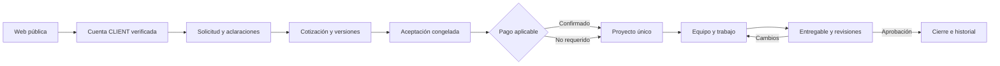

# Plan de implementación de IDEVERA STUDIO

Fecha: 11 de octubre de 2026. Fuente de alcance: [requisitos del cliente v1.0](../IDEVERA_REQUERIMIENTOS_CLIENTE_MVP_V1.docx). Este plan organiza toda la primera versión del documento; las fases son entregas de desarrollo, no recortes del producto.

Construiremos una sola plataforma con web pública y áreas CLIENT, STAFF y OWNER. Primero fijaremos permisos y diseño; después implementaremos el recorrido comercial y el trabajo de proyectos. Cada módulo se entregará con interfaz, reglas de backend y validación del flujo. El criterio de finalización será poder recorrer el producto completo con cuentas de distintos roles.

## Cómo leer el mapa

| Documento | Para qué sirve |
| --- | --- |
| [Mapa de pantallas y permisos](MAPA_DE_PANTALLAS_Y_PERMISOS.md) | Navegación, rutas propuestas, acciones y visibilidad por rol |
| [Arquitectura y dominio](ARQUITECTURA_Y_DOMINIO.md) | Organización del código, entidades, estados y consistencia |
| [Guía de diseño](../DESIGN.md) | Composición, componentes, responsive y movimiento |
| [Matriz de requisitos](MATRIZ_DE_REQUISITOS.md) | Los 96 identificadores del Word y cómo comprobaremos su cumplimiento |

Los requisitos del Word definen las funciones, permisos y estados del producto. La aclaración del usuario del 11 de octubre de 2026 define su contexto como proyecto de pruebas, desarrollado en local hasta terminarlo. Rutas, nombres técnicos de tablas, composición visual y distribución de fases son propuestas de implementación. Las decisiones de negocio aún abiertas se registran al final; se resuelven antes de construir el flujo que dependa de ellas. No se renombrarán ni ampliarán estados del documento sin una decisión explícita.

## Contexto de pruebas y publicación posterior

- Todo el desarrollo y la validación principal se harán en local hasta completar el proyecto.
- No se comprará un dominio ni se requiere una cuenta oficial de Culqi para esta versión de pruebas.
- PayPal sí forma parte de la integración prevista. Se planifica Sandbox para ensayar el circuito sin cobros reales; cualquier activación Live sería una decisión posterior explícita.
- Culqi no tendrá integración real en esta entrega. Si se usa una simulación para explorar una pantalla, quedará identificada como tal y no se presentará como una integración verificada.
- Los pagos, roles, estados, archivos, historial y demás reglas de producto conservarán su funcionamiento y validación de backend aunque los datos sean de prueba.
- Correo local mediante log o visor de desarrollo es suficiente para verificar los flujos; un proveedor de entrega externa se decide solo si se necesita para la demostración posterior.
- Al terminar se evaluará, opcionalmente, un alojamiento y una base de datos gratuitos. Todavía no se selecciona servicio ni se publica la aplicación.

La aceptación de esta entrega será funcional en local con datos de prueba, integración PayPal Sandbox y evidencia de las reglas críticas. Una publicación de demostración y una operación comercial con pagos reales son hitos distintos.

## Punto de partida

| Elemento | Estado al preparar el mapa |
| --- | --- |
| Laravel 13, React, TypeScript, Inertia, Tailwind y pnpm | Instalados en `idevera-base/` |
| PostgreSQL | Conexión comprobada; cinco migraciones iniciales ejecutadas |
| Comprobaciones de código | Compilación y comprobaciones completas aprobadas; 40 pruebas de la plantilla |
| Registro y acceso | El usuario confirmó registro, verificación mediante log y acceso al dashboard |
| Git | Primer commit comprobado; push confirmado por el usuario; no se ha comprobado el resultado remoto del workflow |
| Diseño | Investigación de referencias disponible; diseño de IDEVERA aún sin implementar |
| Correo | Modo `log` para pruebas locales; envío externo opcional para una demo posterior |
| Negocio | Roles, solicitudes, cotizaciones, proyectos, colaboración, pagos y CMS de IDEVERA pendientes |

Las 40 pruebas actuales cubren la plantilla. Cada fase añadirá las pruebas necesarias para las reglas del producto.

## Recorrido del producto

La secuencia respeta el recorrido del Word: pago aplicable antes de crear el proyecto. La aceptación será un registro propio, para mantener referencia e idempotencia antes de existir el proyecto. Queda por definir si ese pago habilitador es un anticipo, un hito o el total. Una aceptación sin pago requerido puede crear el proyecto directamente.

Chat, archivos privados, notificaciones y auditoría acompañan el recorrido. El estado operacional del proyecto y el financiero se mantienen separados.

## Fases y dependencias

| Fase | Entrega | Depende de | Evidencia para cerrarla |
| --- | --- | --- | --- |
| F0 | Preparación del entorno | — | Base instalada, PostgreSQL, autenticación de prueba y Git; completada |
| F1 | Roles y base de permisos | F0 | Áreas por rol, cuentas administradas solo por OWNER, estados restrictivos efectivos y provisión local; aislamiento de proyectos/asignaciones se verifica en F4–F7 |
| F2 | Diseño y componentes de IDEVERA | Mapa actual; se puede avanzar junto a F1 | Home y detalle de proyecto del cliente con la misma identidad, responsive y movimiento reducido |
| F3 | Web pública y contenido administrable | F1, F2 | OWNER publica servicios y portfolio; cambios aparecen en la web; contenido no publicado permanece privado |
| F4 | Solicitudes y revisión | F1, F2; componentes públicos de F3 | CLIENT guarda y envía borrador; OWNER pide aclaración; CLIENT responde; notas internas protegidas |
| F5 | Cotizaciones, negociación y aceptación | F4 | Versiones históricas intactas; aceptación única incluso con doble clic o concurrencia |
| F6 | Proyectos, equipo y trabajo | F5 | Proyecto único por aceptación; asignaciones, EPIC/STORY/TASK, historial y dashboards funcionales |
| F7 | Entregables y colaboración completa | F6 | Revisión interna, envío, cambios y aprobación; chat persistente, archivos y notificaciones integrados |
| F8 | Pagos e integraciones de prueba | F5–F7; configuración PayPal Sandbox | Confirmación verificada en Sandbox, backend autoritativo, reintentos sin duplicar y recorrido local completo |
| F9 | Validación integral local | F1–F8 | Pruebas por rol, concurrencia, PostgreSQL, responsive, accesibilidad, SEO y operación local; demo externa opcional al finalizar |

Las piezas de privacidad, archivos, auditoría y notificaciones empiezan con su primer consumidor, no al final. F7 completa su cobertura. F8 conecta el proveedor de pruebas con el recorrido completo; los proyectos creados para probar F6 antes de esa integración son fixtures de desarrollo.

## Qué construiremos en cada fase

### F1 Roles y permisos

Fase completada: checks aprobados y validación manual de `/owner/accounts` y dos factores confirmada por el usuario el 11 de octubre de 2026. La implementación, evidencia y procedimiento local están en [F1: roles y acceso](F1_ROLES_Y_ACCESO.md). Las políticas de proyectos se completan con el módulo correspondiente.

- Añadir los perfiles de cliente y staff, sus estados y las especialidades independientes.
- Asignar CLIENT desde el backend en el registro; ignorar o rechazar campos de rol enviados por el navegador.
- Provisionar OWNER mediante un procedimiento local controlado; nunca mediante un formulario público.
- Implementar middleware de cuenta y política de usuarios; cada recurso tendrá política e aislamiento por propiedad/asignación al construirse en F4–F7.
- Mantener verificación de correo, recuperación de contraseña y protección reforzada de OWNER. Revisar la eliminación física de cuenta de la plantilla para adaptarla a desactivación, retención y derechos sobre datos.
- Crear cuentas de prueba por rol sin secretos en Git y sin cambiar el rol de la cuenta real de forma automática.

### F2 Diseño y base visual

- Prototipar la home y el detalle de proyecto de CLIENT siguiendo [DESIGN.md](../DESIGN.md).
- Construir tokens, tipografía, botones, formularios, navegación pública y shell de paneles.
- Diseñar estados de datos, validación, permisos, conflicto, conexión perdida y acciones requeridas.
- Probar móvil, tablet, escritorio, teclado y `prefers-reduced-motion`.
- Evaluar la entrega del HTML público para SEO con SSR de Inertia y comprobarla localmente; conservar sus necesidades de runtime para elegir alojamiento más adelante.

### F3 Web pública y CMS

- Home, listado y detalle de servicios, portfolio y casos, About, proceso, contacto, páginas legales y 404.
- Administración de servicios, contenido público seleccionado y portfolio desde OWNER.
- Imágenes públicas elegidas expresamente; separar sus copias de los adjuntos privados.
- Metadata, previews, canonical, sitemap e indexación; excluir áreas privadas de indexación.
- Contenido provisional identificado hasta disponer de textos y proyectos propios. El formulario de contacto tendrá validación y control de abuso; su destino se define antes de conectarlo.

### F4 Solicitudes

- Formulario por pasos con borrador persistente, progreso y recuperación después de error.
- Datos del brief, referencias y adjuntos privados con límites visibles.
- Bandeja OWNER, detalle, notas internas, aclaraciones e historial de estados.
- Primera mensajería contextual, notificaciones internas y acciones requeridas.
- Transiciones verificadas por backend; no aceptar ediciones incompatibles con el estado actual.

### F5 Cotizaciones

- Familias y versiones, alcance, entregables, moneda, importes, vigencia, exclusiones e hitos.
- Vista de CLIENT y editor OWNER; negociación contextual.
- Publicación de versiones y marcación de vistas sin alterar contenido histórico.
- Aceptación, rechazo, retiro y expiración con reglas explícitas.
- Snapshot de la aceptación; restricciones de unicidad, transacción e idempotencia.
- Datos de pago asociados a la aceptación para respetar el pago previo a la creación del proyecto.

### F6 Proyectos y trabajo

- Creación autoritativa desde aceptación elegible y vínculo único entre ambas.
- Resumen, alcance aceptado, equipo, responsables, cronología y estado financiero separado.
- Responsabilidades TEAM_MEMBER, PROJECT_LEAD y SCRUM_MASTER, independientes de especialidad y rol global.
- Lista y tablero EPIC/STORY/TASK con asignación, prioridad, comentarios, archivos e historial.
- Dashboards específicos por rol y filtro de contenido compartido con el cliente.
- Sin rankings automáticos ni puntuación de productividad del staff.

### F7 Entregables y colaboración

- Versiones de entregable, revisión interna, publicación al cliente, cambios y aprobación.
- Chat de solicitudes y proyectos con participantes autorizados, adjuntos, lectura e historial.
- Notificaciones no leídas, mensajes no leídos y acciones requeridas separados.
- Primera entrega del chat con consulta incremental periódica; añadir realtime si la experiencia lo requiere, conservando autorización y recuperación de mensajes.
- Historial después del cierre y políticas de retención. La aprobación de un entregable no completará automáticamente el proyecto sin cumplir la regla acordada.

### F8 Pagos e integraciones de prueba

- Integrar PayPal Sandbox con cuentas de prueba y credenciales locales del entorno de desarrollo. Sandbox simula operaciones sin usar cuentas Live para las transacciones. [Guía oficial](https://developer.paypal.com/sandbox-testing/overview).
- Hitos, intentos de pago y conciliación; webhook autenticado y eventos deduplicados.
- Soportar el vocabulario completo de transacciones e historial de reembolsos, disputas y reversos. Mapear los eventos disponibles de PayPal; usar fixtures o simulaciones identificadas para casos no reproducibles en Sandbox, distinguiendo prueba de dominio de integración comprobada.
- Conectar la condición de pago con la creación del proyecto sin duplicaciones.
- Verificar correo mediante log/visor local, colas, scheduler, almacenamiento privado local y restauración de prueba.
- Resolver el acceso del proveedor a los callbacks cuando se prueben webhooks en local. Si hace falta un endpoint accesible temporalmente, se prepara en esa fase y no equivale a desplegar todo el proyecto.
- El retorno del navegador desde un checkout no confirma por sí solo un pago.

### F9 Validación local y demo posterior opcional

- Recorrer con cuentas de prueba independientes el circuito comercial y de entrega completo en local, con PayPal Sandbox.
- Probar URLs y acciones de recursos ajenos, cuentas restringidas y asignaciones revocadas.
- Probar aceptación simultánea, webhooks duplicados y fuera de orden, cargas interrumpidas y aprobación de versiones antiguas.
- Ejecutar pruebas de reglas críticas en PostgreSQL además de la suite rápida de SQLite.
- Revisar pantallas y movimiento en dispositivos reales, teclado y reducción de movimiento; medir carga y estabilidad.
- Preparar páginas legales y procesos de datos como parte del producto, señalando los textos provisionales de la demo. Una operación comercial posterior requerirá su validación para el contexto real.
- Al completar la validación local, evaluar si se publica una demo con servicios gratuitos. Revisar soporte de PHP/Laravel, PostgreSQL, persistencia de archivos, SSR, colas, scheduler, límites y suspensión por inactividad; no basta con subir archivos a un hosting estático.
- Si se decide publicar, preparar HTTPS, secretos externos al repositorio, configuración de pruebas y recuperación. Identificar la demo como entorno de pruebas. No se activa automáticamente PayPal Live ni se integra una cuenta oficial de Culqi.

## Cómo trabajaremos una funcionalidad

1. Elegir un requisito de la matriz y comprobar sus dependencias y decisiones pendientes.
2. Definir comportamiento, permisos y estados de la pantalla.
3. Diseñar la interfaz y sus variantes de carga, vacío, éxito y error.
4. Implementar datos, validación, políticas y acción de dominio junto con la interfaz.
5. Verificar el recorrido y las situaciones adversas que importan para esa regla.
6. Actualizar la matriz con evidencia y cerrar el cambio en Git.

Mantendremos cambios pequeños y revisables en ramas por fase o funcionalidad. No se instala una dependencia por aparecer en una referencia visual: debe resolver una necesidad concreta y tener licencia compatible. El usuario puede ejecutar instalaciones, pruebas y operaciones locales guiadas; los cambios de código y documentación se revisan en el repositorio.

## Criterio común de terminado

Una entrega está terminada cuando funciona desde la interfaz con datos persistidos, tiene autorización de backend, conserva los estados del Word, muestra errores comprensibles, funciona en móvil y teclado, mantiene privacidad e historial y supera los checks apropiados. Para acciones críticas se exige evidencia de reintentos y concurrencia. Ver una pantalla con datos de ejemplo no cierra un requisito de negocio.

En este proyecto las comprobaciones se realizan en local y los pagos se ensayan en Sandbox. Una prueba mediante fixtures acredita la lógica probada, pero no certifica una operación externa del proveedor. No es requisito para terminar comprar un dominio, contratar hosting o habilitar cobros reales.

Se mantienen `pnpm run build` y `composer ci:check` como comprobaciones principales. Se añaden pruebas de acceso, transiciones y flujos, y casos en PostgreSQL para las restricciones y bloqueos que SQLite no reproduzca. No se necesitan tests nuevos para cambios puramente documentales.

## Decisiones pendientes y momento de resolverlas

| ID | Decisión | Propuesta inicial | Resolver antes de |
| --- | --- | --- | --- |
| D01 | Una persona con varios perfiles globales | Adoptado al iniciar F1: un rol global por cuenta; responsabilidades de proyecto y especialidades separadas | Resuelta para F1 |
| D02 | Facultades de PROJECT_LEAD y SCRUM_MASTER | F1 define un catálogo independiente; poderes y asignaciones se concretan en F6 sin autoridad financiera implícita | F6 |
| D03 | Acceso de cuentas suspendidas, inactivas o desactivadas | F1 bloquea rutas privadas y conserva inicio público, logout, recuperación y verificación. Reactivación por OWNER; historial y derechos de datos se concretan con sus módulos | Base resuelta en F1; historial F7/F9 |
| D04 | Idioma, textos y recursos propios | Interfaz en español y slogan original en inglés; wordmark provisional; contenido del estudio proporcionado o validado por el usuario | F2/F3 |
| D05 | Textos y operación legal | Definir entidad, jurisdicción, retención, derechos sobre datos y políticas de cancelación/reembolso; no usar un texto genérico como validación legal | F3/F9 |
| D06 | Límites y tipos de archivos | Definir límites por contexto, formatos, cuotas y retención antes de habilitar cargas | F4 |
| D07 | Cancelación, reapertura y aprobación | Confirmar quién puede cancelar, qué ocurre con versiones/hitos y cuándo se permite reabrir trabajo o entregables | F4–F7 |
| D08 | Condición de pago que habilita proyecto | Respetar pago aplicable antes de creación; definir anticipo, hito, total o NOT_REQUIRED y condición de onboarding | F5/F8 |
| D09 | Movimiento complejo del hero | CSS/SVG y componentes existentes primero; elegir una biblioteca solo si el prototipo lo exige | F2 |
| D10 | Mensajería inmediata | Consulta incremental inicial; decidir si se necesitan WebSockets según la experiencia esperada | F7 |
| D11 | Proveedores y posible demo gratuita | PayPal incluido, inicialmente Sandbox; sin dominio comprado ni cuenta oficial Culqi. Correo y archivos locales. Elegir hosting/base gratuitos solo si se decide publicar al terminar | PayPal en F8; alojamiento después de F9 |
| D12 | Notificación por canal | Definir eventos enviados por correo y cuáles solo dentro de la plataforma; evitar confundirlos con acciones requeridas | F4/F8 |
| D13 | Contacto e invitación al staff | F1: alta de STAFF por OWNER y contraseña por recuperación, con correo local. Contacto e invitación externa específica pendientes | Alta resuelta en F1; contacto F3 |

No hace falta resolver todas estas decisiones para empezar. La primera tanda será D01–D04 y el prototipo de F2. Las demás conservan su lugar en el mapa y se concretan cuando corresponda.

## Primera tanda de trabajo

- [x] Registrar D01 y base de D03/D13 en F1; D02 queda para F6 y D04 para F2.
- [x] Implementar y probar política de usuarios, estados y áreas por rol en F1; migración aplicada localmente.
- [x] Acceso OWNER a `/owner/accounts` y dos factores comprobados manualmente por el usuario.
- [ ] Diseñar home y detalle de proyecto CLIENT con contenido de prueba identificado.
- [ ] Revisar composición y animaciones en móvil y escritorio.
- [ ] Construir los componentes compartidos y conectar el primer flujo de permisos.

El orden permite comprobar pronto que IDEVERA tiene la calidad visual buscada, mientras se construye la base de seguridad necesaria para sus áreas privadas.
